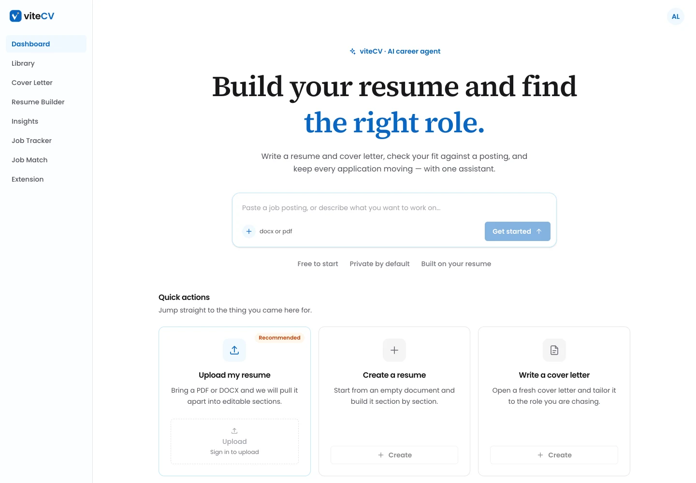
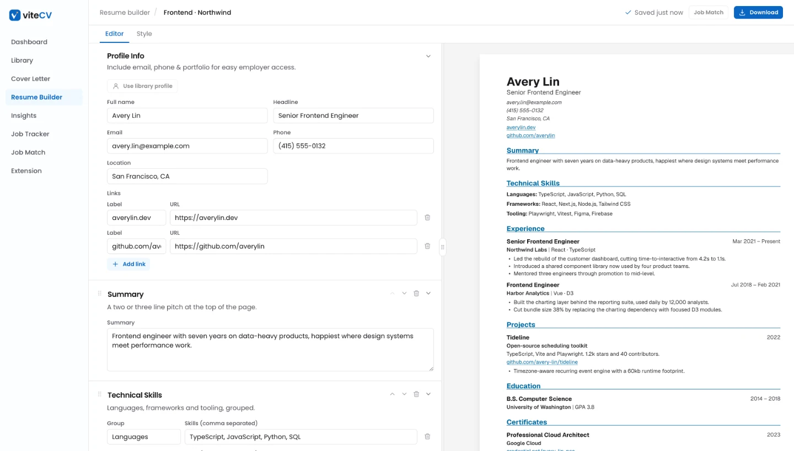
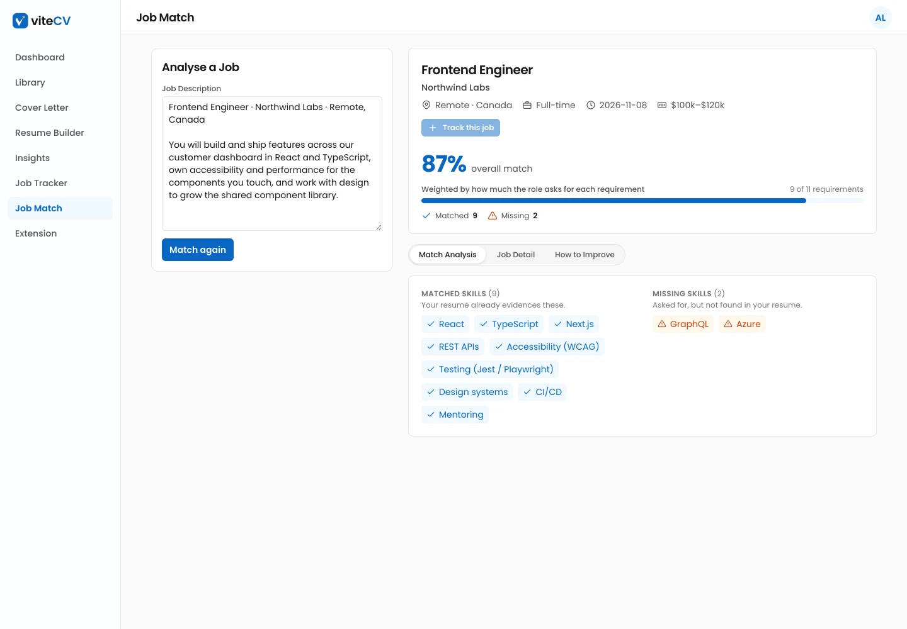
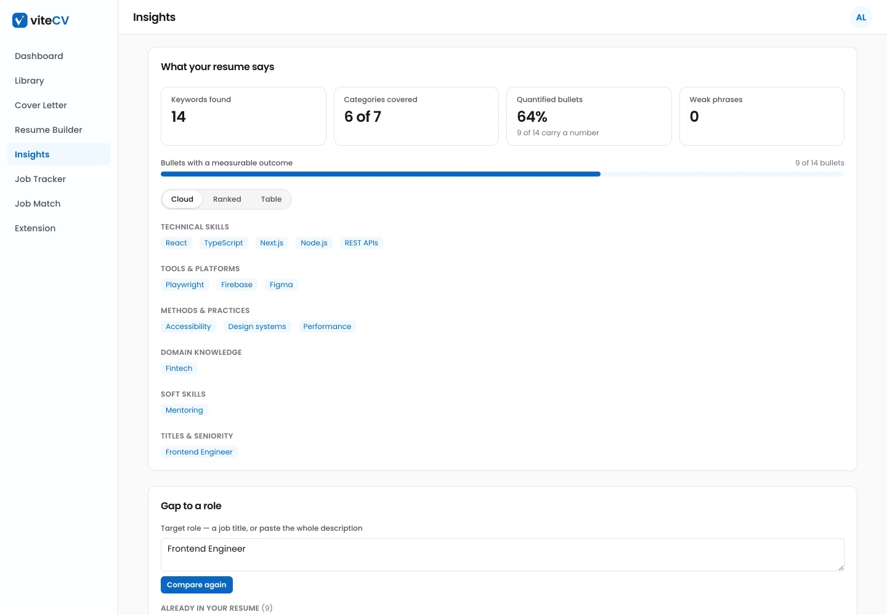
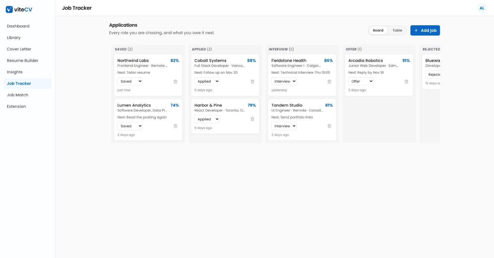
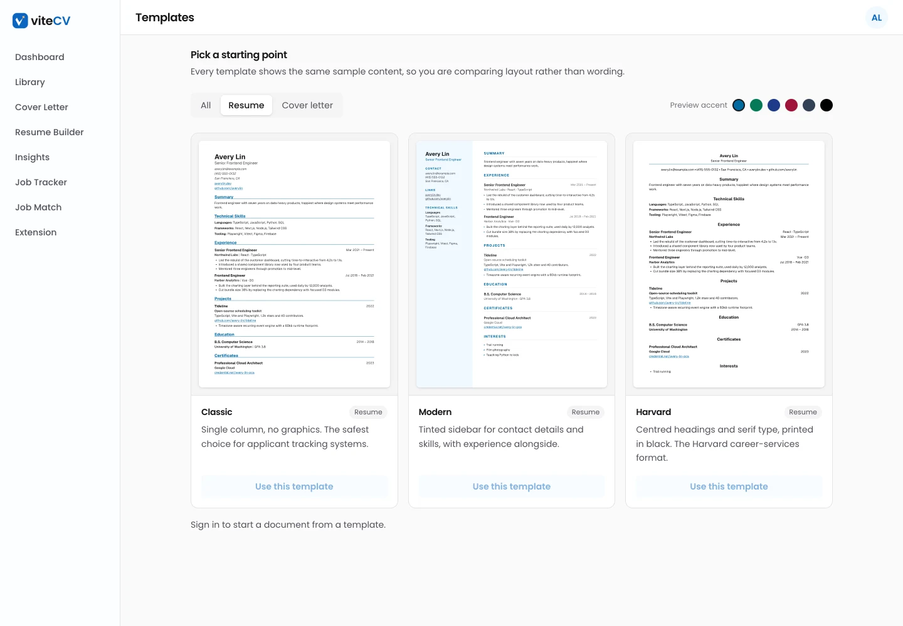

<div align="center">

<picture>
  <source media="(prefers-color-scheme: dark)" srcset="public/brand/lockup-dark.svg"/>
  
</picture>

**Build your resume and find the right role.**

An AI career agent: a resume builder typeset by Typst, job matching against your real experience,<br/>insights, a job tracker, and a Chrome extension that saves postings as you browse.

     

[What it does](#what-it-does) · [How it works](#how-it-works) · [Screens](#screens) · [Run it](#run-it-locally) · [Configuration](#configuration)

<br/>

<picture>
  <source media="(prefers-color-scheme: dark)" srcset="docs/readme/hero-dark.svg"/>
  
</picture>

</div>

## What it does

- **Resume Builder.** Upload a PDF or DOCX and edit what is pulled out, section by section, or start from scratch. Templates and a Style panel (accent, font pair, sizes) change the look without touching the content.
- **Cover Letter.** The same editor, templates and Typst output, for the letter that goes with each application.
- **Job Match.** Paste or upload a posting. Each requirement is weighted by importance and checked against your resume. The result is a score, the skills you already prove, the gaps, and how to close them.
- **Insights.** Keywords by category, how many bullets carry a number, weak phrases with suggested rewrites, and the gap to a target role.
- **Job Tracker.** Every application on one board, from Saved to Offer, with its match score and what you owe it next.
- **Library.** Every bullet, project and skill in one place, ready to pull into any resume.
- **Chrome extension.** A side panel on LinkedIn, Indeed and other career sites that saves the posting to your tracker and shows your match.

## How it works

### The preview is the PDF

Resumes and cover letters are typeset by [Typst](https://typst.app), compiled to WebAssembly ([typst.ts](https://github.com/Myriad-Dreamin/typst.ts)), in the browser. The editor preview, the template thumbnails and the **Download** button all use the same engine, so the PDF is exactly what the preview shows: real text, clickable links, no print dialog.

<picture>
  <source media="(prefers-color-scheme: dark)" srcset="docs/readme/pipeline-dark.svg"/>
  
</picture>

```
ResumeDocument --toTypstResume()--> JSON --sys.inputs.doc--> public/typst/main.typ
                                                               --> templates/resume/<id>.typ
```

`libs/typst/resumeDoc.ts` and `coverLetterDoc.ts` are the only places a document is shaped for Typst; templates are pure styling. `libs/typst/theme.ts` maps the Style panel to Typst, and fonts are vendored in `public/typst/fonts`.

### Matching against evidence, not keywords

Job Match and Insights send the resume text and the posting to an LLM (`libs/insights/glm.ts`). Every response is normalised into typed payloads (`libs/insights/insightSchema.ts`) before anything renders. The score is weighted by importance, so a missing must-have costs more than a missing nice-to-have.

<picture>
  <source media="(prefers-color-scheme: dark)" srcset="docs/readme/match-dark.svg"/>
  
</picture>

### The extension pairs with a one-time code

The extension never sees your Google session. On the **Extension** page you request a short code, which works once and expires. The extension exchanges it at `/api/extension/pair` for a revocable bearer token, then calls `/api/jobs*` with that token. `proxy.ts` lets those routes through without the session cookie, and each one verifies the token itself.

<picture>
  <source media="(prefers-color-scheme: dark)" srcset="docs/readme/extension-dark.svg"/>
  
</picture>

### Auth and data

1. The browser signs in with Google through the Firebase client SDK.
2. It sends the ID token to the `createSession` server action. The server verifies the token with the Admin SDK and exchanges it for a signed **session cookie** (`libs/firebase/admin.ts`, `actions/auth-action.ts`).
3. `proxy.ts` does a cheap cookie-presence check to gate routes. `libs/dal.ts` does the authoritative `verifySessionCookie` check.
4. Firestore access is authorized separately, by `firestore.rules`. They scope every document under `users/{uid}` to that user, and that is the real data boundary.

## Screens

<table>
  <tr>
    <td width="50%"><picture><source media="(prefers-color-scheme: dark)" srcset="docs/readme/dashboard-dark.webp"/></picture><br/><sub><b>Dashboard.</b> Start from a posting, a file, or a quick action.</sub></td>
    <td width="50%"><picture><source media="(prefers-color-scheme: dark)" srcset="docs/readme/resume-dark.webp"/></picture><br/><sub><b>Resume Builder.</b> Edit on the left; Typst typesets the page on the right.</sub></td>
  </tr>
  <tr>
    <td width="50%"><picture><source media="(prefers-color-scheme: dark)" srcset="docs/readme/job-match-dark.webp"/></picture><br/><sub><b>Job Match.</b> Score, matched skills, gaps, and how to improve.</sub></td>
    <td width="50%"><picture><source media="(prefers-color-scheme: dark)" srcset="docs/readme/insights-dark.webp"/></picture><br/><sub><b>Insights.</b> What your resume says, by category.</sub></td>
  </tr>
  <tr>
    <td width="50%"><picture><source media="(prefers-color-scheme: dark)" srcset="docs/readme/job-tracker-dark.webp"/></picture><br/><sub><b>Job Tracker.</b> Every application, from Saved to Offer.</sub></td>
    <td width="50%"><picture><source media="(prefers-color-scheme: dark)" srcset="docs/readme/templates-dark.webp"/></picture><br/><sub><b>Templates.</b> Real Typst thumbnails of the same sample resume.</sub></td>
  </tr>
</table>

<sub>Screens show the built-in demo (`/demo/*`, development only) with fictional people and companies.</sub>

## Run it locally

Requires Node 22.12 or newer.

```sh
npm install
cp .env.example .env    # then fill it in, see Configuration
npm run dev             # http://localhost:3000
```

In the Firebase console, enable **Authentication → Sign-in method → Google** and create a **Firestore** database. Then deploy the security rules. Rules only take effect once deployed:

```sh
npx firebase-tools deploy --only firestore:rules
```

**Demo without an account.** In development, `/demo/dashboard` renders the real components with fixtures from `data/demoFixtures.ts`: no sign-in and no Firestore. Production builds return 404 for the whole `/demo` tree.

**The extension.** Open `chrome://extensions`, turn on Developer mode, choose **Load unpacked** and pick `extension/`. Then pair it from the app's **Extension** page.

## Configuration

| Variable | |
|---|---|
| `NEXT_PUBLIC_FIREBASE_*` | Web app config, from *Project settings → General → Your apps*. Not secret; it ships to the browser |
| `FIREBASE_PROJECT_ID`, `FIREBASE_CLIENT_EMAIL`, `FIREBASE_PRIVATE_KEY` | Service account, from *Project settings → Service accounts*. **Secret**, used server-side only to verify ID tokens and mint session cookies |
| `GLM_API_KEY` | Key for the LLM behind parsing, Insights and Job Match |
| `GLM_MODEL`, `GLM_BASE_URL`, `GLM_REASONING_EFFORT` | Optional, default `glm-5.3-flash`, `https://api.z.ai/api`, `low` |
| `NEXT_PUBLIC_SITE_URL` | Optional, the public URL used for link previews (Open Graph) |

## Project layout

| Path | Purpose |
|---|---|
| `app/page.tsx` | Public landing page |
| `app/(app)/` | Routes inside the app chrome (sidebar), gated by session |
| `app/demo/` | Development-only demo of the app on fixtures, for screenshots |
| `app/api/` | Bearer-token routes for the extension |
| `actions/` | Server actions |
| `components/` | UI. `components/motion/` holds the brand animations: logo reveal, loader, AI sparkle, success check, empty state |
| `libs/dal.ts` | Session verification, the Data Access Layer |
| `libs/typst/` | Typst engine (browser), document → Typst JSON, theme mapping |
| `libs/insights/` | LLM client, prompts, typed payloads and match scoring |
| `libs/jobtracker/` | Tracker data, extension tokens and pairing |
| `public/typst/` | Typst entry point, templates and vendored fonts |
| `public/brand/` | Logo lockups, marks and word art |
| `extension/` | The Chrome extension (Manifest V3) |
| `proxy.ts` | Optimistic route gate (Next 16 renamed `middleware` → `proxy`) |

**Adding a template:** write `public/typst/templates/<resume|letter>/<id>.typ` exporting `render(data)`, add it to `public/typst/main.typ` and to `SOURCES` in `libs/typst/client.ts`, then add the id to the schema and the template registry.

## Design

One system across the app, the extension and the marketing assets:

- **Colour.** Brand blue `#0A66C2` marks action, and burnt orange marks AI and highlights. Dark mode is charcoal `#222222` with sky blue `#54A6D8`. Documents stay white paper in both modes.
- **Type.** Source Serif 4 for headlines, Poppins for everything you click or read, and Geist Mono for codes.
- **Motion.** Stroke draw-ons and one sparkle, with tokens in `app/globals.css`. Every animation stops under `prefers-reduced-motion` and shows its final frame.

## Status

A personal project, in progress. The extension is loaded unpacked and is not yet on the Chrome Web Store.
